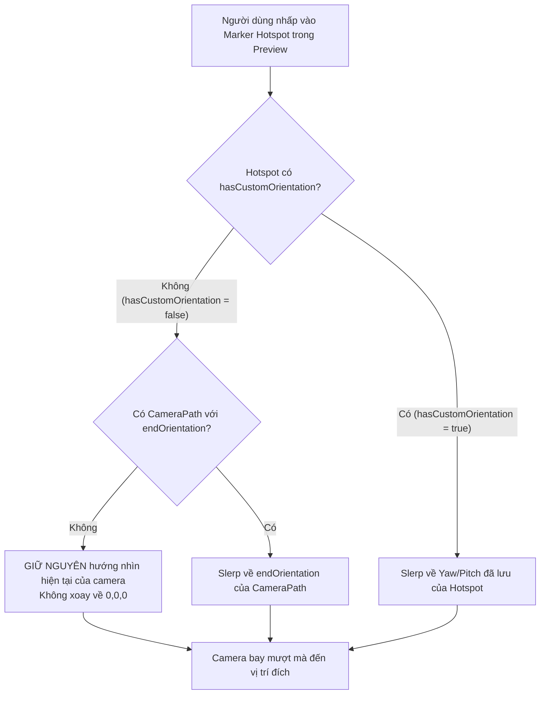

# Kế hoạch: Phân định Cơ chế Góc nhìn Camera & Khắc phục Hiện tượng Góc nhìn Mặc định (0, 0, 0)

## 1. Mục tiêu & Giải đáp Thắc mắc của Người dùng

### 1.1. Hệ thống có đang mock dữ liệu ảo không?
**Hoàn toàn KHÔNG mock dữ liệu ảo trong quá trình vận hành.**
- Toàn bộ cơ chế: Tìm đường đồ thị A*, kiểm tra va chạm Line-of-Sight bằng Raycasting 2 chiều, điều khiển Gizmo 3 trục XYZ, nội suy đường cong Spline Catmull-Rom và xoay chuyển hướng nhìn bằng Quaternion Slerp đều **chạy tính toán hình học thực tế 100% trên Three.js**.
- Tuy nhiên, trong mã nguồn có **dữ liệu mẫu khởi tạo (Seed/Sample Data)**: Khi người dùng mở ứng dụng lần đầu mà chưa có dữ liệu lưu trong trình duyệt, hàm `loadSampleModel('modern_apartment')` tự động tạo 3 Hotspot mẫu (`Phòng khách`, `Khu bếp`, `Phòng ngủ`) và 1 Tuyến mẫu (`Phòng khách → Bếp`) để người dùng không phải đối mặt với màn hình trống.

### 1.2. Tại sao người dùng chưa thiết lập góc nhìn nhưng bấm vẫn xoay ra góc nhìn mới?
Nguyên nhân kỹ thuật chính xác:
1. Khi một Hotspot được tạo (hoặc trong 3 Hotspot mẫu khởi tạo), thuộc tính `rotation` được gán giá trị mặc định là `{ x: 0, y: 0, z: 0 }`.
2. Trong Three.js, góc quay Euler `(Pitch: 0°, Yaw: 0°, Roll: 0°)` không mang ý nghĩa là "chưa thiết lập", mà là một hướng nhìn tuyệt đối trong không gian thế giới: **nhìn thẳng song song với trục $-Z$**.
3. Trong `CameraPathfindingService.ts` (dòng 242-246):
   ```ts
   const hYaw = destHotspot.rotation?.y || 0;
   const hPitch = destHotspot.rotation?.x || 0;
   const hRoll = destHotspot.rotation?.z || 0;
   const qDest = this.eulerToQuaternion(hYaw, hPitch, hRoll);
   ```
   Hệ thống coi giá trị mặc định `(0, 0, 0)` này là góc nhìn đích bắt buộc và truyền cho `CameraNavigator`.
4. Trong lúc bay, `CameraNavigator` thực hiện `quaternion.slerp` từ hướng nhìn hiện tại của camera về góc `(0, 0, 0)`.
5. Kết quả: Người dùng đang xoay ngắm một góc bất kỳ, bấm vào marker thì camera bị **ép xoay về hướng trục $-Z$**, tạo cảm giác như hệ thống tự "bịa" ra một góc nhìn ảo.

---

## 2. Giải pháp Đề xuất

### 2.1. Phân biệt rõ rệt: "Chưa thiết lập góc nhìn" vs "Đã thiết lập góc nhìn đích"

Thêm thuộc tính `hasCustomOrientation?: boolean` vào `HotspotItem`:
- **Khi `hasCustomOrientation === false` (hoặc `undefined`)**: Hotspot này **chưa được người dùng chỉ định góc nhìn đích**.
  - **Hành vi khi bay đến**: Camera **GIỮ NGUYÊN hướng nhìn hiện tại của người dùng** (Current Viewport Orientation), hoặc nhìn theo chiều tiến của camera (Tangent), **tuyệt đối không ép xoay về trục $-Z$ (0,0,0)**. Người dùng đang nhìn góc nào thì sau khi bay đến vị trí mới vẫn giữ nguyên góc nhìn tự do đó.
- **Khi `hasCustomOrientation === true`**: Người dùng đã chủ động lưu góc nhìn cho Hotspot này.
  - Camera sẽ `slerp` mượt mà đến đúng góc nhìn Yaw/Pitch/Roll đã lưu.

### 2.2. Ưu tiên hướng nhìn từ Tuyến Camera (`CameraPath.endOrientation`)

Nếu người dùng click vào Hotspot đích mà giữa điểm xuất phát và Hotspot đó có một Camera Path đã được cấu hình `endOrientation` (thông qua công cụ trực quan *"Đặt hướng nhìn cuối"* trên Topbar):
- Hệ thống sẽ ưu tiên áp dụng `endOrientation` của tuyến đó thay vì giá trị mặc định.

### 2.3. Bổ sung công cụ trực quan "Lấy góc nhìn camera hiện tại" trên bảng thuộc tính Hotspot

Hiện tại, người dùng chỉ có thể gõ số vào 3 ô Yaw, Pitch, Roll trên bảng thuộc tính Hotspot, chưa có nút chụp nhanh góc nhìn:
- Bổ sung nút **`📷 Lấy góc nhìn camera hiện tại`** (Capture Current Camera View) trên Property Panel của Hotspot.
- Khi người dùng xoay 3D đến góc ưng ý và nhấn nút này:
  - Hệ thống tự động đọc `Yaw` và `Pitch` thực tế của camera trong viewport.
  - Điền số vào các ô nhập và đánh dấu `hasCustomOrientation = true`.
- Bổ sung nút **`🔄 Đặt lại (Góc nhìn tự do)`**:
  - Đưa `hasCustomOrientation` về `false`, xóa góc nhìn cố định để camera tự do xoay khi bay tới.

---

## 3. Các thay đổi chi tiết theo tệp mã nguồn



---

### [Component 1] Hotspot Data Model & Store
#### [MODIFY] `src/modules/hotspots/types/hotspot.types.ts`
- Thêm trường `hasCustomOrientation?: boolean` vào interface `HotspotItem`.

#### [MODIFY] `src/EditorApp.ts`
- Trong hàm `createHotspot` (khi người dùng click đặt hotspot mới): Đặt `hasCustomOrientation: false`.
- Trong hàm `applyLoadedModel` (dữ liệu mẫu ban đầu): Đặt `hasCustomOrientation: false` cho cả 3 hotspot mẫu.

---

### [Component 2] Thuật toán Tìm đường & Điều hướng Camera
#### [MODIFY] `src/modules/camera-path/services/CameraPathfindingService.ts`
- Trong hàm `findOptimalRoute(...)`:
  - Kiểm tra nếu Hotspot đích có `hasCustomOrientation === true`: Lấy góc nhìn từ `destHotspot.rotation`.
  - Nếu có `incomingPath?.endOrientation?.mode === 'custom'`: Lấy góc nhìn từ `incomingPath.endOrientation`.
  - Nếu **cả hai đều không có** (chưa thiết lập): Trả về `targetQuaternion = currentCameraQuaternion.clone()`.
  - Khi đó, camera chỉ tịnh tiến vị trí đến đích mà không xoay giật sang hướng khác.

#### [MODIFY] `src/core/navigation/CameraNavigator.ts`
- Đảm bảo trong hàm `navigateToWaypoint(...)` và `navigateToHotspot(...)`:
  - Nếu đích không có góc nhìn cố định, góc nhìn xuất phát và góc nhìn kết thúc bằng nhau $\to$ quaternion slerp không làm đổi góc nhìn, giữ nguyên trải nghiệm tự do cho người dùng.

---

### [Component 3] Giao diện Bảng Thuộc tính Hotspot (Property Panel)
#### [MODIFY] `index.html`
- Thêm hàng nút công cụ bên dưới phần *Góc xoay hướng nhìn*:
  - Nút `btn-capture-hotspot-view`: **"📷 Lấy góc nhìn camera hiện tại"**.
  - Nút `btn-reset-hotspot-view`: **"Đặt lại góc nhìn tự do"**.
  - Huy hiệu trạng thái: `badge-orientation-status` ("Tự do / Chưa đặt" hoặc "Đã cố định: Yaw ...°, Pitch ...°").

#### [MODIFY] `src/modules/hotspots/ui/PropertyPanel.ts`
- Lắng nghe sự kiện click `btn-capture-hotspot-view`:
  - Lấy góc `yaw` và `pitch` hiện tại từ `sceneManager.camera`.
  - Cập nhật vào Hotspot và gọi `UpdateHotspotCommand` để hỗ trợ Undo/Redo.
- Lắng nghe `btn-reset-hotspot-view`:
  - Xóa cờ `hasCustomOrientation`.

---

## 4. Kế hoạch Kiểm thử & Nghiệm thu (Verification Plan)

### 4.1. Kiểm thử tự động (Automated Tests)
- Tạo file kiểm thử mới: `tests/verify_orientation_policy.mjs`:
  1. **Test 1**: Tạo Hotspot mới (chưa thiết lập góc nhìn) $\to$ `findOptimalRoute` trả về đúng quaternion hiện tại của camera (không xoay về 0,0,0).
  2. **Test 2**: Thiết lập `hasCustomOrientation = true` với Yaw = 120°, Pitch = -15° $\to$ `findOptimalRoute` trả về đúng quaternion mục tiêu.
  3. **Test 3**: Hotspot chưa thiết lập góc nhìn nhưng Camera Path nối đến có `endOrientation` $\to$ ưu tiên lấy `endOrientation` của Camera Path.
  4. **Test 4**: Regression test toàn bộ 7 test Navigation và 8 test Camera Path trước đó.

### 4.2. Kiểm thử thủ công trên trình duyệt
1. Mở trình duyệt tại `http://localhost:5173/`.
2. Xoay camera tự do ngắm nhìn một góc bất kỳ trong phòng khách.
3. Chuyển sang chế độ **"Xem trước (Preview)"** và nhấn vào marker **"Khu vực Bếp & Bàn ăn"**:
   - *Kết quả mong đợi:* Camera lướt đến khu bếp nhưng **vẫn giữ nguyên góc nhìn quan sát của người dùng**, không bị xoay đột ngột về hướng cố định nào.
4. Chuyển lại chế độ **"Biên tập"**, chọn một Hotspot, xoay camera đến góc đẹp và nhấn nút **"📷 Lấy góc nhìn camera hiện tại"** trên bảng thuộc tính bên phải.
5. Quay lại chế độ **"Xem trước (Preview)"**, xoay đi hướng khác rồi nhấn vào Hotspot vừa lưu:
   - *Kết quả mong đợi:* Camera vừa di chuyển vừa xoay mượt mà đến đúng góc nhìn đẹp vừa lưu.
