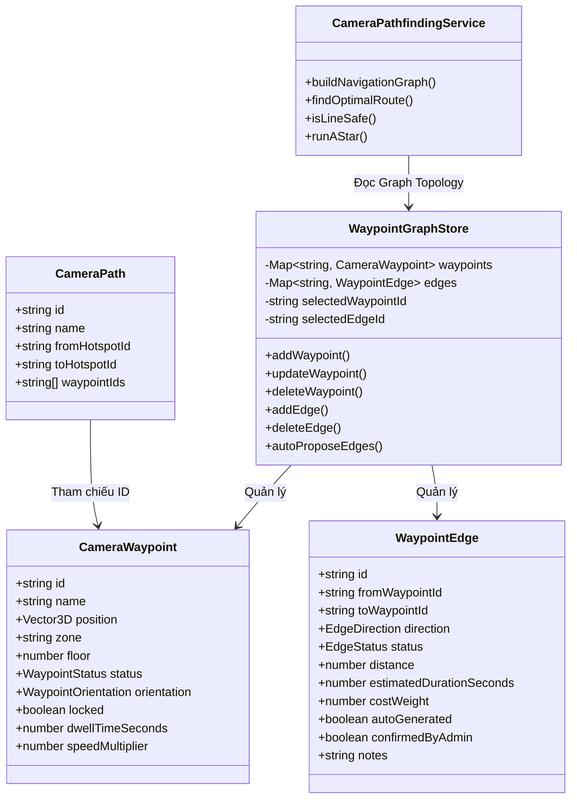

# Kế Hoạch Triển Khai: Global Waypoint Graph Editor

Hệ thống **Global Waypoint Graph Editor** quản lý mạng lưới waypoint dùng chung cho toàn bộ mô hình 3D, tự đề xuất các kết nối hợp lệ, kiểm tra chẩn đoán mạng liên thông, và cho phép camera ở bất kỳ vị trí nào tự tìm đường an toàn đến hotspot mà không cần tạo Camera Path riêng cho từng cặp hotspot.

---

## 1. Mục Tiêu & Nguyên Tắc Kiến Trúc

### A. Nguyên Tắc Cốt Lõi
1. **Độc Lập & Dùng Chung (Global Library):** Waypoint và Edge tồn tại độc lập với Camera Path. Waypoint chưa thuộc tuyến nào vẫn tham gia đầy đủ vào Global Graph để phục vụ tìm đường tự do.
2. **Không Bao Giờ Phá Hủy Mô Hình Gốc:** Toàn bộ dữ liệu Graph, Waypoints, Edges và Paths được lưu trữ độc lập trong cấu hình JSON (Schema v1.3.0), không tác động vào file GLB/USDZ gốc.
3. **An Toàn Hình Học Tuyệt Đối (No Blind Euclid):** Tuyệt đối không dùng khoảng cách đường thẳng làm bằng chứng kết nối an toàn. Mọi cạnh và đoạn nối camera đều được kiểm tra va chạm xuyên tường bằng thuật toán raycast 2 chiều (Bi-directional Center Ray) kết hợp 2 tia biên an toàn (Clearance Radius) và giới hạn chênh lệch độ cao ($\Delta Y$).
4. **Không Can Thiệp Màn Hình Người Dùng:** Tuyệt đối tuân thủ quy tắc toàn hệ thống: không dùng Win32 API, script mô phỏng chuột bàn phím hay can thiệp vào trình duyệt Chrome của Chủ dự án. Mọi tương tác diễn ra trên giao diện 3D Web chuẩn và CLI chạy ngầm.

---

## 2. Kiến Trúc Dữ Liệu & Sơ Đồ Hệ Thống



### Chi tiết Schema v1.3.0

```typescript
export type WaypointStatus = 'active' | 'draft' | 'disabled';
export type EdgeDirection = 'bidirectional' | 'unidirectional';
export type EdgeStatus = 'valid' | 'blocked' | 'untested' | 'needs_confirmation';

export interface WaypointEdge {
  id: string;                      // UUID
  fromWaypointId: string;          // Node A
  toWaypointId: string;            // Node B
  direction: EdgeDirection;        // Hai chiều (bidirectional) hoặc Một chiều (unidirectional)
  status: EdgeStatus;              // 'valid' | 'blocked' | 'untested' | 'needs_confirmation'
  distance: number;                // Chiều dài thực tế (mét)
  estimatedDurationSeconds?: number;// Thời gian dự kiến di chuyển qua cạnh
  costWeight?: number;             // Hệ số chi phí (mặc định 1.0)
  autoGenerated?: boolean;         // Do hệ thống tự đề xuất
  confirmedByAdmin?: boolean;      // Quản trị viên đã xác nhận an toàn
  notes?: string;                  // Ghi chú
  createdAt: string;
  updatedAt: string;
}

export interface CameraWaypoint {
  id: string;                      // UUID ổn định
  name: string;                    // Tên hiển thị (e.g. "Hành lang P1")
  position: Vector3D;              // Tọa độ 3D thực tế
  zone?: string;                   // Khu vực (e.g. "Phòng khách", "Sảnh")
  floor?: number;                  // Tầng (e.g. 1, 2)
  status?: WaypointStatus;         // Trạng thái ('active', 'draft', 'disabled')
  orientation: WaypointOrientation;
  locked: boolean;                 // Khóa không cho kéo gizmo
  dwellTimeSeconds: number;        // Thời gian dừng
  speedMultiplier?: number;        // Hệ số tốc độ
  createdAt: string;
  updatedAt: string;
}

export interface ProjectConfigSchema {
  schemaVersion: '1.0.0' | '1.1.0' | '1.2.0' | '1.3.0';
  projectId: string;
  projectName: string;
  updatedAt: string;
  modelInfo: ModelInfoMeta;
  hotspots: HotspotItem[];
  waypoints?: CameraWaypoint[];     // Tương thích ngược 100%
  waypointEdges?: WaypointEdge[];   // Danh sách các cạnh kết nối toàn cục
  cameraPaths?: CameraPath[];
  settings: ViewerSettings;
}
```

---

## 3. Các Thành Phần Triển Khai Chi Tiết

### A. Quản lý Waypoint Toàn Cục & Cạnh Kết Nối (Store & Commands)
- **`WaypointGraphStore.ts` [NEW]:**
  - Quản lý tập trung toàn bộ `CameraWaypoint` và `WaypointEdge`.
  - Hỗ trợ thêm, sửa, xóa, nhân bản, khóa/mở khóa waypoint.
  - Khi xóa hoặc di chuyển waypoint: tự động cập nhật các edge liên quan, đồng thời cảnh báo nếu có `CameraPath` đang chứa waypoint đó.
  - Phương thức `autoProposeConnections(options)`: quét các cặp waypoint trong bán kính cấu hình (`maxDistance`, ví dụ 6-10m) và chênh lệch độ cao (`maxHeightDiff`, ví dụ 1.5m), kiểm tra tia raycast an toàn, tự động sinh đề xuất edge với trạng thái `valid` hoặc `needs_confirmation`.
- **Command Pattern cho Undo/Redo [NEW]:**
  - `AddGlobalWaypointCommand`: Thêm waypoint toàn cục và khôi phục khi Undo.
  - `DeleteGlobalWaypointCommand`: Xóa waypoint kèm việc sao lưu toàn bộ edges và path links để khôi phục hoàn hảo khi Undo.
  - `MoveGlobalWaypointCommand`: Lưu tọa độ cũ/mới và cập nhật độ dài các edge liên quan.
  - `AddEdgeCommand`, `DeleteEdgeCommand`, `UpdateEdgeCommand`: Quản lý thêm/xóa/đổi trạng thái edge.

### B. Kiểm Tra Vật Cản & Tính Toán Chi Phí Kết Nối (Edge Collision Checker)
- **Tích hợp trong `CameraPathfindingService.ts` [MODIFY]:**
  - Kiểm tra tia va chạm nâng cao:
    1. Tia trung tâm thuận: $A \to B$ (Raycast Center Forward).
    2. Tia trung tâm nghịch: $B \to A$ (Raycast Center Reverse - bắt mặt trái Backface).
    3. Hai tia cánh bên trái/phải với bán kính an toàn `clearanceRadius = 0.25m` (Side Clearance Rays - chống cọ tường hoặc mép cửa hẹp).
    4. Kiểm tra chênh lệch cao độ: nếu $|\Delta Y| > \text{maxHeightDiff}$ (mặc định $1.5\text{m}$), phân loại là khác tầng hoặc cầu thang hẹp $\to$ gán trạng thái `needs_confirmation` hoặc từ chối kết nối.
  - Lưu chi phí: $\text{Cost} = \text{Distance} \times \text{costWeight} + \text{TurnPenalty}$.

### C. Tìm Đường Đồ Thị A* Cho Camera Ở Vị Trí Bất Kỳ
- **Quy trình khi người dùng nhấn Hotspot:**
  1. Lấy vị trí $P_{cam}$ và hướng nhìn $Q_{cam}$ hiện tại của camera.
  2. Lấy vị trí đích $P_{dest}$ và hướng nhìn chuẩn $Q_{dest}$ của Hotspot đích (`cameraView.cameraPosition` & `cameraView.yaw/pitch`).
  3. **Đoạn nối tạm thời đầu tuyến (Start Bridge):** Tìm waypoint hoặc điểm trên cạnh graph gần camera nhất có đường nhìn thông thoáng (raycast safe, $|\Delta Y| \le 1.5\text{m}$).
  4. **Đoạn nối tạm thời cuối tuyến (End Bridge):** Kiểm tra đường nhìn từ graph node gần nhất tới $P_{dest}$.
  5. **Tìm đường A* trên Graph:** Duyệt qua các edge có trạng thái `valid` hoặc `confirmedByAdmin`, bỏ qua các edge `blocked`.
  6. **Ghép hành trình liên tục:** Nối $[P_{cam}] \to [\text{Graph Nodes}] \to [P_{dest}]$ thành một đường cong Catmull-Rom thống nhất.
  7. **Nội suy xoay mượt mà:** Sử dụng [`SmoothRotationService`](file:///Z:/01_du_an/PRJ_092_3DWeb/src/modules/camera-path/services/SmoothRotationService.ts) để slerp cung ngắn nhất, giữ ổn định roll = $0.0000^\circ$, và về đích khớp chính xác $100\%$ hướng nhìn của Hotspot.
  8. Đoạn nối tạm thời tuyệt đối **không** tự lưu vào cấu hình lâu dài trừ khi quản trị viên yêu cầu.
  9. Nếu camera bị tường vây kín không có kết nối an toàn tới graph: hiển thị thông báo toast màu vàng rõ ràng:
     `"Không tìm thấy đường an toàn từ vị trí hiện tại đến [Tên Hotspot]. Khu vực này bị tường ngăn và chưa có Waypoint kết nối. Vui lòng di chuyển camera hoặc thêm Waypoint."`

### D. Hiển Thị 3D Mạng Waypoint & Tương Tác Trực Quan (3D Visualization)
- **`GlobalGraphVisualizer.ts` [NEW]:**
  - Hiển thị toàn bộ Waypoint với marker 3D (hình cầu neon hoặc khối kim cương), nhãn tên CSS2D hoặc billboard, và huy hiệu trạng thái (Active, Draft, Cô lập).
  - Hiển thị cạnh kết nối:
    - Màu xanh ngọc lục bảo (`#10b981`): Cạnh `valid` an toàn.
    - Màu đỏ tươi (`#ef4444`): Cạnh `blocked` bị vật cản chặn.
    - Màu hổ phách (`#f59e0b`): Cạnh `needs_confirmation` cần duyệt.
    - Màu xám nhạt (`#64748b`): Cạnh `untested`.
    - Mũi tên chỉ hướng trên cạnh 1 chiều.
  - Highlight cạnh và các điểm lân cận (Neighbors) khi chọn một Waypoint.
  - Vẽ highlight tuyến đường A* vừa tìm được bằng vệt sáng rực rỡ để người dùng nghiệm thu ngay trong 3D.
  - Nút bấm nhanh trên Viewport: `#btn-toggle-graph-overlay` để Bật/Tắt hiển thị mạng Waypoint bất kỳ lúc nào.

### E. Công Cụ Chẩn Đoán Mạng Toàn Cục (Network Diagnostics Suite)
- **`GraphDiagnosticsService.ts` [NEW]:**
  - **Điểm cô lập (Isolated Nodes):** Tìm các waypoint có bậc liên kết = 0.
  - **Các nhóm đảo không liên thông (Disconnected Islands):** Sử dụng thuật toán BFS / Disjoint Set Union (DSU) để phát hiện các phân vùng đồ thị không thể đi qua lại.
  - **Kiểm tra va chạm toàn mạng (Obstacle Audit):** Quét lại toàn bộ edges trong mô hình 3D để phát hiện cạnh bị xuyên tường sau khi di chuyển đồ đạc/mô hình.
  - **Điểm ngoài phạm vi (Out of Bounds):** Phát hiện waypoint nằm ngoài khung hộp `boundsCenter` / `boundsSize` của mô hình.
  - **Khả năng tiếp cận Hotspot (Hotspot Reachability):** Kiểm tra xem có Hotspot nào không thể tới được từ mạng Waypoint.
- **`GraphDiagnosticsModal.ts` [NEW]:**
  - Bảng báo cáo trực quan trong giao diện với thống kê số liệu và danh sách lỗi.
  - Các nút hành động tức thì: "Focus vào điểm lỗi trong 3D", "Xóa cạnh bị chặn", "Tự động kết nối đảo", "Chạy thử tìm đường (Test Route)".

### F. Giao Diện Biên Tập Mạng Waypoint (UI Workbench)
- **Tab Chế độ mới trên Topbar (`tab-mode-graph`):**
  - Nằm cạnh tab "Hotspots" và "Tuyến Camera".
  - Khi kích hoạt: mở thanh công cụ Mạng Waypoint (`#topbar-graph-actions`): Thêm Waypoint, Tự động liên kết, Kiểm tra mạng.
- **Sidebar Trái (`#panel-graph-content`):**
  - Danh sách Waypoint toàn cục, bộ lọc theo khu vực/trạng thái/kết nối.
  - Cấu hình bán kính tự động liên kết (`maxDistance`, `maxHeightDiff`).
- **Sidebar Phải (Graph Inspector):**
  - Khi chọn Waypoint: hiển thị thông tin, tọa độ X/Y/Z, khu vực, tầng, trạng thái, danh sách các điểm đang nối (Neighbors) kèm khoảng cách và nút xóa/thêm nối.
  - Khi chọn Cạnh: hiển thị 2 điểm đầu cuối, hướng (1 chiều / 2 chiều), trạng thái, khoảng cách mét, nút kiểm tra lại raycast và nút xác nhận an toàn.

---

## 4. Đánh Giá Kiến Trúc: Waypoint Graph vs NavMesh (Recast Navigation)

| Tiêu chí | Global Waypoint Graph (Hệ thống hiện tại) | NavMesh (Recast Navigation / three-pathfinding) |
| :--- | :--- | :--- |
| **Bản chất** | Đồ thị không gian thưa (Sparse Topological Graph). | Lưới đa giác không gian đi lại liên tục (Polygon Mesh). |
| **Kiểm soát đường đi** | **Tuyệt đối:** Camera đi chính xác theo các hành lang được chỉ định, tránh góc cua xấu, đậm chất điện ảnh (Cinematic). | **Tự do:** Đi theo đa giác, có thể bị ôm sát góc tường nếu không có agent radius và polygon smoothing chuẩn. |
| **Trọng lượng & Tải** | Siêu nhẹ (~vài KB JSON), không cần thư viện WASM ngoài. | Nặng hơn (~vài trăm KB tới MB), cần nạp thư viện Recast WASM (~1.5MB). |
| **Độ phủ góc tự do** | Phụ thuộc vào mật độ waypoint do người dùng/hệ thống đặt. | Rất cao: mọi điểm trên sàn đều có thể tìm đường tự động. |
| **Tính tương thích** | Hoạt động ngay trên mọi thiết bị và trình duyệt, không rủi ro memory leak. | Phức tạp trong khâu build voxelization trên trình duyệt với các file GLB phức tạp. |

> [!NOTE]
> **Chiến lược Tương lai (Future NavMesh Architecture):**
> Hệ thống được thiết kế theo mẫu `INavigationPathfinder` trừu tượng. `WaypointGraphPathfinder` đóng vai trò là backend hiện tại. Trong tương lai khi cần tích hợp Recast Navigation, module NavMesh chỉ cần triển khai cùng interface `INavigationPathfinder` để bổ sung khả năng sinh đường đi tự do từ mọi điểm trên sàn, trong khi toàn bộ hệ thống `CameraNavigator`, `SmoothRotationService`, và cơ chế hướng nhìn đích của Hotspot được tái sử dụng 100%.

---

## 5. Danh Sách Tệp Sửa Đổi & Tạo Mới

### Tệp Tạo Mới:
1. [`src/modules/camera-path/store/WaypointGraphStore.ts`](file:///Z:/01_du_an/PRJ_092_3DWeb/src/modules/camera-path/store/WaypointGraphStore.ts) - Store quản lý toàn bộ Waypoint và Edge toàn cục.
2. [`src/modules/camera-path/types/waypointGraph.types.ts`](file:///Z:/01_du_an/PRJ_092_3DWeb/src/modules/camera-path/types/waypointGraph.types.ts) - Định nghĩa kiểu dữ liệu `WaypointEdge`, `WaypointStatus`, `EdgeStatus`, `GraphDiagnosticsReport`.
3. [`src/modules/camera-path/components/GlobalGraphVisualizer.ts`](file:///Z:/01_du_an/PRJ_092_3DWeb/src/modules/camera-path/components/GlobalGraphVisualizer.ts) - Trực quan hóa 3D Waypoint, Edge màu sắc, hướng mũi tên và tuyến đường tìm kiếm.
4. [`src/modules/camera-path/services/GraphDiagnosticsService.ts`](file:///Z:/01_du_an/PRJ_092_3DWeb/src/modules/camera-path/services/GraphDiagnosticsService.ts) - Dịch vụ chẩn đoán mạng, phát hiện đảo cô lập, cạnh va chạm và độ phủ hotspot.
5. [`src/modules/camera-path/ui/GraphPanel.ts`](file:///Z:/01_du_an/PRJ_092_3DWeb/src/modules/camera-path/ui/GraphPanel.ts) - Bảng điều khiển danh sách Waypoint & Cấu hình liên kết tự động bên Sidebar trái.
6. [`src/modules/camera-path/ui/GraphPropertyPanel.ts`](file:///Z:/01_du_an/PRJ_092_3DWeb/src/modules/camera-path/ui/GraphPropertyPanel.ts) - Bảng Inspector thuộc tính Waypoint & Cạnh kết nối bên Sidebar phải.
7. [`src/modules/camera-path/ui/GraphDiagnosticsModal.ts`](file:///Z:/01_du_an/PRJ_092_3DWeb/src/modules/camera-path/ui/GraphDiagnosticsModal.ts) - Modal hiển thị kết quả chẩn đoán và công cụ thử nghiệm đường đi.
8. [`src/modules/camera-path/commands/AddGlobalWaypointCommand.ts`](file:///Z:/01_du_an/PRJ_092_3DWeb/src/modules/camera-path/commands/AddGlobalWaypointCommand.ts) - Command thêm waypoint toàn cục.
9. [`src/modules/camera-path/commands/DeleteGlobalWaypointCommand.ts`](file:///Z:/01_du_an/PRJ_092_3DWeb/src/modules/camera-path/commands/DeleteGlobalWaypointCommand.ts) - Command xóa waypoint và phục hồi edges.
10. [`src/modules/camera-path/commands/MoveGlobalWaypointCommand.ts`](file:///Z:/01_du_an/PRJ_092_3DWeb/src/modules/camera-path/commands/MoveGlobalWaypointCommand.ts) - Command di chuyển waypoint toàn cục.
11. [`src/modules/camera-path/commands/AddEdgeCommand.ts`](file:///Z:/01_du_an/PRJ_092_3DWeb/src/modules/camera-path/commands/AddEdgeCommand.ts) - Command thêm cạnh kết nối.
12. [`src/modules/camera-path/commands/DeleteEdgeCommand.ts`](file:///Z:/01_du_an/PRJ_092_3DWeb/src/modules/camera-path/commands/DeleteEdgeCommand.ts) - Command xóa cạnh kết nối.
13. [`tests/verify_global_waypoint_graph.mjs`](file:///Z:/01_du_an/PRJ_092_3DWeb/tests/verify_global_waypoint_graph.mjs) - Bộ kiểm thử tự động toàn diện 10 kịch bản theo yêu cầu mục H.

### Tệp Sửa Đổi:
1. [`src/modules/camera-path/types/cameraPath.types.ts`](file:///Z:/01_du_an/PRJ_092_3DWeb/src/modules/camera-path/types/cameraPath.types.ts) - Bổ sung các trường `zone`, `floor`, `status` cho `CameraWaypoint`.
2. [`src/modules/camera-path/store/CameraPathStore.ts`](file:///Z:/01_du_an/PRJ_092_3DWeb/src/modules/camera-path/store/CameraPathStore.ts) - Tách biệt thư viện waypoint, không xóa waypoint khi xóa path, tương tác đồng bộ với `WaypointGraphStore`.
3. [`src/modules/camera-path/services/CameraPathfindingService.ts`](file:///Z:/01_du_an/PRJ_092_3DWeb/src/modules/camera-path/services/CameraPathfindingService.ts) - Nâng cấp thuật toán xây dựng đồ thị từ `WaypointEdge`, hỗ trợ kết nối tạm thời từ camera tự do, và xử lý A* với edge chi phí/hướng.
4. [`src/modules/config/types/config.types.ts`](file:///Z:/01_du_an/PRJ_092_3DWeb/src/modules/config/types/config.types.ts) - Nâng cấp `schemaVersion: '1.3.0'`, bổ sung `waypointEdges?: WaypointEdge[]`.
5. [`src/modules/config/services/ConfigStorageService.ts`](file:///Z:/01_du_an/PRJ_092_3DWeb/src/modules/config/services/ConfigStorageService.ts) - Lưu và nạp `waypointEdges`, tương thích ngược hoàn hảo với schema v1.0.0, v1.1.0 và v1.2.0.
6. [`src/EditorApp.ts`](file:///Z:/01_du_an/PRJ_092_3DWeb/src/EditorApp.ts) - Tích hợp chuyển đổi 3 chế độ (Hotspot, Tuyến Camera, Mạng Waypoint), điều phối Gizmo, Visualizer và Diagnostics Modal.
7. [`index.html`](file:///Z:/01_du_an/PRJ_092_3DWeb/index.html) - Bổ sung tab Mạng Waypoint trên Topbar, Topbar Action buttons, Panel danh sách cạnh/waypoint bên trái, Inspector bên phải, nút Toggle Viewport Overlay và Diagnostics Modal.
8. [`tests/check_dom_ids.mjs`](file:///Z:/01_du_an/PRJ_092_3DWeb/tests/check_dom_ids.mjs) - Cập nhật kiểm tra các DOM ID mới.

---

## 6. Kế Hoạch Kiểm Thử Tự Động (10 Kịch Bản Theo Mục H)

Bộ kiểm thử [`tests/verify_global_waypoint_graph.mjs`](file:///Z:/01_du_an/PRJ_092_3DWeb/tests/verify_global_waypoint_graph.mjs) sẽ kiểm tra nghiêm ngặt:
1. **Test 1: Thêm Waypoint độc lập chưa thuộc Camera Path:** Khẳng định waypoint tham gia đồ thị mà không cần gán vào path nào.
2. **Test 2: Tự động đề xuất và tạo kết nối hợp lệ:** Kiểm tra `autoProposeConnections` tự sinh các cạnh hai chiều an toàn giữa các waypoint gần nhau.
3. **Test 3: Phát hiện vật cản bằng Raycast đa tia:** Kiểm tra hai waypoint cách nhau gần nhưng có bức tường chắn ở giữa $\to$ hệ thống đánh dấu `blocked` hoặc từ chối kết nối, không cho phép xuyên tường.
4. **Test 4: Tìm đường khi camera đứng gần mạng waypoint:** Camera tự nối vào waypoint khả dĩ gần nhất và tìm đường A* thành công.
5. **Test 5: Tìm đường khi camera đứng tự do giữa phòng:** Camera tạo đoạn nối tạm thời an toàn tới cạnh/node gần nhất và bay mượt mà đến đích.
6. **Test 6: Xử lý camera bị cô lập / phòng kín không có đường ra:** Báo lỗi `BLOCKED_BY_GEOMETRY` với cảnh báo chi tiết, không tạo đường snap xuyên tường.
7. **Test 7: Tìm đường qua chuỗi liên kết phức tạp đến Hotspot khác:** Duyệt qua 4-5 node đồ thị và kết thúc với hướng nhìn chuẩn của Hotspot đích.
8. **Test 8: Kiểm tra tính chất một chiều và hai chiều:** Cạnh một chiều chỉ cho phép đi theo đúng hướng $A \to B$, ngăn cản đi ngược $B \to A$.
9. **Test 9: Di chuyển hoặc xóa waypoint đang sử dụng:** Cập nhật độ dài các cạnh liên quan khi di chuyển; khi xóa waypoint thì xóa an toàn các cạnh liên đới và cảnh báo Camera Path bị ảnh hưởng.
10. **Test 10: Toàn vẹn dữ liệu Schema v1.3.0 & Tương thích ngược:** Xuất JSON, tải lại, xác nhận 100% tọa độ, edges, trạng thái và tương thích với file v1.2.0 cũ.

---

## 7. Hướng Dẫn Nghiệm Thu Trực Tiếp Cho Chủ Dự Án

Sau khi triển khai xong, Chủ dự án có thể mở trình duyệt tại `http://localhost:5173/` để kiểm tra trực tiếp:
1. Chuyển sang tab **"Mạng Waypoint"** trên thanh Topbar:
   - Thử thêm các điểm Waypoint rải rác trong các phòng mà không cần tạo Tuyến Camera.
   - Bấm nút **"Tự động liên kết"**: quan sát các đường nối màu xanh ngọc lục bảo xuất hiện giữa các điểm thông thoáng.
   - Thử đặt 1 điểm sau bức tường và bấm liên kết: quan sát đường nối chuyển sang màu đỏ (`blocked`) hoặc không tạo kết nối.
2. Bấm nút **"Kiểm tra mạng"**: xem báo cáo chẩn đoán các điểm cô lập hoặc các phòng chưa thông nhau.
3. Chuyển sang chế độ **"Xem trước" (Preview)**:
   - Đưa camera đến một góc bất kỳ trong phòng khách, bấm vào một Hotspot ở khu vực khác:
   - Quan sát camera tự tìm lối đi an toàn men theo mạng Waypoint và bay êm ái về góc nhìn đích của Hotspot đó!
