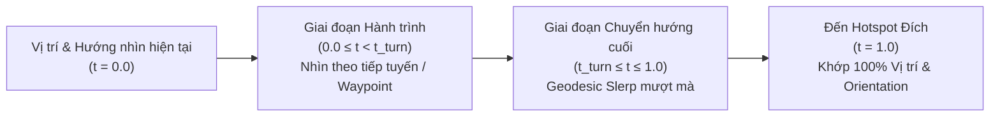
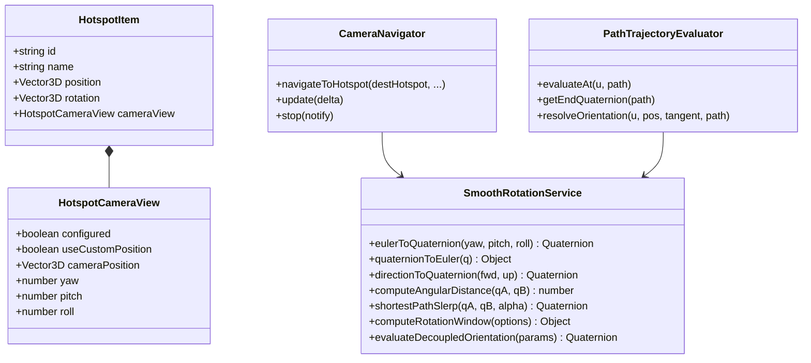

# Kế hoạch Triển khai: Hotspot Destination Orientation & Smooth Camera Rotation

## 1. Tổng quan Mục tiêu & Bối cảnh

Mục tiêu cốt lõi của module là giải quyết triệt để vấn đề: **Khi người dùng nhấn vào bất kỳ Hotspot nào hoặc chạy Camera Path, camera vừa di chuyển vừa chuyển hướng nhìn một cách tự nhiên và liên tục để khi đến đích, hướng nhìn khớp chính xác với cấu hình chuẩn của Hotspot**.

### Thách thức Kỹ thuật Hiện tại
1. **Hướng di chuyển và hướng nhìn đích là hai thông tin độc lập**: Ví dụ camera đi thẳng từ cửa vào phòng khách, nhưng hotspot đích bên ban công yêu cầu khi tới nơi phải nhìn ra góc vườn (lệch $90^\circ$ hoặc $180^\circ$ so với tiếp tuyến đường đi).
2. **Hiện tượng giật góc nhìn (Angle Snap / Discontinuity)**: Trong code hiện tại của [`CameraNavigator.ts`](file:///Z:/01_du_an/PRJ_092_3DWeb/src/core/navigation/CameraNavigator.ts), nhánh xử lý `if (progress < 0.8)` và `else` nội suy từ `startQuaternion` khiến góc quay tại $progress = 0.80$ bị nhảy đột ngột từ hướng tiếp tuyến sang hướng đích với $\alpha_{eased} \approx 0.68$.
3. **Cung quay và giới hạn tốc độ góc**: Khi góc lệch lớn ($180^\circ$) trên tuyến ngắn, nếu không có cơ chế giới hạn tốc độ góc (`rotationSpeedLimit`), camera sẽ quay giật tốc độ cao gây chóng mặt.
4. **Trục Up và nguy cơ lật camera**: Phải bảo đảm camera luôn giữ trục thẳng đứng $(0, 1, 0)$, không phát sinh roll ngoài ý muốn.

---

## 2. Yêu cầu Duyệt từ Người dùng (User Review Required)

> [!IMPORTANT]
> **Các quyết định kiến trúc quan trọng cần Người dùng xác nhận:**
> 1. **Dịch vụ chuẩn hóa `SmoothRotationService`**: Chúng tôi đề xuất tạo mới dịch vụ toán học trung tâm `SmoothRotationService` dùng chung cho cả **CameraNavigator** (khi nhấn Hotspot / bay tự do) và **PathTrajectoryEvaluator** (khi chạy Preview tuyến Camera). Điều này bảo đảm mọi chuyển động camera trong toàn hệ thống đều tuân theo đúng 1 chuẩn toán học mượt mà.
> 2. **Giới hạn tốc độ góc tối đa (`rotationSpeedLimit`)**: Mặc định đặt ở mức $180^\circ/\text{s}$ ($\pi\text{ rad/s}$). Nếu một tuyến ngắn có góc quay lớn (ví dụ lệch $180^\circ$ nhưng khoảng cách chỉ $1.5\text{m}$), hệ thống sẽ tự động điều chỉnh thời lượng tối thiểu của tuyến lên ít nhất $1.8\text{s} - 2.2\text{s}$ để chuyển động xoay đạt chuẩn điện ảnh (cinematic) và không gây chóng mặt.
> 3. **Điểm bắt đầu chuyển hướng cuối (`uTurnStart`)**: Mặc định bắt đầu từ $50\% - 70\%$ của hành trình (hoặc $2.0\text{s}$ cuối đối với tuyến dài). Tại điểm giao này, góc nhìn được chuyển tiếp liên tục với đạo hàm bậc một và bậc hai bằng 0 (zero angular jerk).

---

## 3. Kiến trúc Chi tiết & Đề xuất Thay đổi

### Component 1: Dịch vụ Xoay Mượt Trung tâm (`SmoothRotationService`)
#### [NEW] `src/modules/camera-path/services/SmoothRotationService.ts`
Chịu trách nhiệm toàn bộ các phép tính toán học nội suy góc nhìn camera:
- `eulerToQuaternion(yaw, pitch, roll)`: Chuyển đổi Euler theo thứ tự `'YXZ'`, kẹp Pitch trong phạm vi $[-85^\circ, 85^\circ]$, triệt tiêu roll ngoài ý muốn.
- `quaternionToEuler(q)`: Giải mã an toàn yaw/pitch từ quaternion.
- `directionToQuaternion(forwardDir, upDir)`: Tạo quaternion nhìn theo vector hướng đi, ép trục up $(0, 1, 0)$ tránh lật camera.
- `computeAngularDistance(qA, qB)`: Tính khoảng cách góc ngắn nhất theo geodesic metric:
  $$\Delta\theta = 2 \arccos(\text{clamp}(|\mathbf{q}_A \cdot \mathbf{q}_B|, 0, 1))$$
- `shortestPathSlerp(qA, qB, alpha)`: Đảm bảo $\mathbf{q}_A \cdot \mathbf{q}_B \ge 0$ trước khi slerp, quay theo cung ngắn nhất $\le 180^\circ$, không quay vòng $360^\circ$.
- `computeRotationWindow(options)`:
  - Tính toán tiến độ $u_{turnStart} \in [0.35, 0.75]$.
  - Kiểm tra điều kiện giới hạn tốc độ góc $\Delta\theta / t_{turn} \le \omega_{max}$. Nếu vượt ngưỡng, tự động điều chỉnh thời lượng tuyến an toàn.
- `evaluateDecoupledOrientation(params)`:
  - Khi $u < u_{turnStart}$: Camera nhìn theo hướng di chuyển $\mathbf{q}_{travel}(u)$ (mượt mà từ hướng xuất phát $\mathbf{q}_{start}$).
  - Khi $u \ge u_{turnStart}$:
    $$\alpha = \frac{u - u_{turnStart}}{1.0 - u_{turnStart}} \in [0, 1]$$
    $$\alpha_{eased} = \text{easeInOutCubic}(\alpha)$$
    $$\mathbf{q}(u) = \text{shortestPathSlerp}(\mathbf{q}_{travel}(u), \mathbf{q}_{dest}, \alpha_{eased})$$
  - Tại $u = u_{turnStart} \implies \alpha_{eased} = 0 \implies \mathbf{q} = \mathbf{q}_{travel}(u_{turnStart})$ (**Sai số bước nhảy = 0**).
  - Tại $u = 1.0 \implies \alpha_{eased} = 1.0 \implies \mathbf{q} = \mathbf{q}_{dest}$ (**Sai số đích = 0**).

---

### Component 2: Cập nhật `CameraNavigator` (Điều hướng Bay tới Hotspot)
#### [MODIFY] `src/core/navigation/CameraNavigator.ts`
- Tích hợp `SmoothRotationService`.
- Khi bắt đầu bay (`navigateToHotspot`):
  - Lấy hướng nhìn chuẩn từ `destHotspot.cameraView`. Nếu chưa cấu hình, fallback giữ nguyên hướng nhìn hiện tại của camera.
  - Tính góc lệch $\Delta\theta$ giữa tiếp tuyến đến và hướng đích.
  - Sử dụng `SmoothRotationService.computeRotationWindow` để tính $u_{turnStart}$ và thời lượng bay phù hợp với `rotationSpeedLimit`.
- Trong hàm `update(delta)`:
  - Vị trí: di chuyển liên tục theo spline hoặc thẳng với `easeInOutCubic`.
  - Hướng nhìn: gọi `SmoothRotationService.evaluateDecoupledOrientation`.
  - Không còn hiện tượng phân nhánh gián đoạn tại $0.8$.
  - Cập nhật mục tiêu `OrbitControls.target` liên tục phía trước camera: $\mathbf{p} + \mathbf{f} \times 5.0\text{m}$.
- Khi hoàn tất ($progress = 1.0$):
  - Gán chính xác $\mathbf{p}_{end}$ và $\mathbf{q}_{end}$.
  - Kích hoạt lại `OrbitControls` tại đúng hướng nhìn đó, bảo đảm người dùng có thể dùng chuột tương tác tiếp ngay lập tức mà không bị giật camera.
- Khi người dùng bấm Hotspot mới giữa lúc đang bay (Interruption):
  - Lấy tức thì vị trí và hướng nhìn thực tế tại frame đó làm điểm xuất phát cho hành trình mới.

---

### Component 3: Cập nhật `PathTrajectoryEvaluator` (Tuyến Camera Path)
#### [MODIFY] `src/modules/camera-path/services/PathTrajectoryEvaluator.ts`
- Cập nhật hàm `resolveOrientation(u, position, tangent, path)`:
  - Sử dụng `SmoothRotationService.evaluateDecoupledOrientation`.
  - Đảm bảo khi chạy thử tuyến Camera Path, đoạn xoay cuối về Hotspot đích diễn ra êm ái, tuân thủ đúng cấu hình `transitionDuration` và easing của tuyến, đồng thời kế thừa `qEnd` từ `toHotspot.cameraView`.

---

### Component 4: Cập nhật `CameraPathfindingService` (Định tuyến & Tính toán Thời lượng)
#### [MODIFY] `src/modules/camera-path/services/CameraPathfindingService.ts`
- Khi tính toán `durationSeconds` cho tuyến tự động:
  - Đảm bảo thời lượng vừa đủ cho vận tốc tịnh tiến ($\sim 2.8\text{m/s}$), vừa đủ cho vận tốc góc chuyển hướng ($\le 180^\circ/\text{s}$).
  - Xử lý các tuyến rất ngắn ($< 1.5\text{m}$) vẫn có đủ thời gian để xoay góc lớn mà không bị giật.

---

### Component 5: Giao diện Căn chỉnh Hotspot Inspector
#### [MODIFY] `index.html` & `src/modules/hotspots/ui/PropertyPanel.ts`
- Cập nhật nhãn và tooltip rõ ràng:
  - Nút **"Thiết lập hướng nhìn đích"** (kèm icon `compass`).
  - Tooltip: "Mở không gian 3D lướt tự do để căn chỉnh vị trí camera và hướng nhìn chuẩn khi đến Hotspot này".
- Giữ nguyên cơ chế phím số Yaw/Pitch/Roll, nút "Chụp góc này", "Xem góc chuẩn", "Đặt lại tự do".

---

## 4. Kế hoạch Kiểm thử & Đo lường Chi tiết (Verification Plan)

### 4.1. Bộ Kiểm thử Tự động Chuyên sâu 10 Kịch bản
Tạo mới file: `tests/verify_smooth_camera_rotation.mjs`

| Kịch bản | Mô tả kiểm thử | Tiêu chí nghiệm thu bắt buộc |
| :--- | :--- | :--- |
| **Test 1** | Đi thẳng đến hotspot, hướng đích quay lệch $90^\circ$ (nhìn ra vườn). | Bước nhảy góc giữa 2 frame liên tiếp $< 8^\circ$; sai số góc đích $= 0.00^\circ$. |
| **Test 2** | Hướng nhìn đích quay ngược $180^\circ$ (nhìn lại cửa vào). | Đi theo cung ngắn nhất $\le 180^\circ$; roll camera $= 0.00^\circ$ (không lật camera). |
| **Test 3** | Di chuyển theo đường cong (spline) trong khi hướng đích lệch hướng khác. | Khớp tiếp tuyến khi đi, chuyển tiếp mượt mà sang hướng đích ở đoạn cuối. |
| **Test 4** | Hai Camera Path khác nhau cùng tới 1 Hotspot. | Cả hai đều đạt cùng vị trí và quaternion đích với sai số $< 0.0001$. |
| **Test 5** | Tuyến tìm đường Waypoint Graph / A* qua nhiều phòng. | Di chuyển quanh vật cản an toàn, xoay mượt vào góc chuẩn khi tiếp cận phòng đích. |
| **Test 6** | Tuyến rất ngắn ($< 1.5\text{m}$, thời lượng ngắn). | Tốc độ góc không vượt quá `rotationSpeedLimit`; không giật, không bỏ qua căn chỉnh. |
| **Test 7** | Đổi Hotspot đích giữa chừng khi đang di chuyển (Interruption). | Animation cũ dừng sạch; animation mới xuất phát từ vị trí và góc nhìn thực tế hiện tại. |
| **Test 8** | Hotspot chưa cấu hình orientation (Fallback an toàn). | Giữ nguyên góc nhìn camera hiện tại, không ép về $(0,0,0)$, không tự ý lưu dữ liệu ảo. |
| **Test 9** | Lưu cấu hình JSON và tải lại. | Dữ liệu `cameraView` và `rotation` nguyên vẹn 100%. |
| **Test 10** | Đo lường độ êm ái & Báo cáo sai số (Error Metrics Report). | Sai số vị trí $< 0.001\text{m}$; sai số góc quay $< 0.01^\circ$; độ giật Jerk $\approx 0$. |

### 4.2. Chạy Kiểm thử Hồi quy Toàn diện
Sau khi hoàn thành, toàn bộ các bộ test hiện có phải tiếp tục PASS 100%:
- `node tests/check_dom_ids.mjs`
- `node ./node_modules/typescript/bin/tsc --noEmit`
- `node --experimental-strip-types tests/verify_hotspot_orientation_architecture.mjs`
- `node tests/verify_camera_path.mjs`
- `node --experimental-strip-types tests/verify_waypoint_gizmo_navigation.mjs`
- `node tests/verify_editor_core.mjs`
- `node --experimental-strip-types tests/verify_smooth_camera_rotation.mjs`

### 4.3. Kiểm thử Nghiệm thu Thủ công trên Trình duyệt
- Mở `http://localhost:5173/`.
- Thiết lập góc nhìn chuẩn cho Hotspot Ban công nhìn ra vườn ($90^\circ$).
- Bấm vào Hotspot Ban công từ cửa vào: quan sát camera lướt tới và từ từ xoay mắt nhìn ra vườn một cách êm ái, dừng lại ổn định.
- Thử đổi hướng nhìn chuẩn thành $180^\circ$ và kiểm tra lại.
- Bấm liên tục chuyển đổi giữa 2 Hotspot khi camera đang bay để xác nhận không giật góc nhìn.

---

> [!TIP]
> Xin mời Chủ dự án xem xét kế hoạch triển khai trên. Khi Chủ dự án xác nhận đồng ý (Proceed), tôi sẽ tiến hành hiện thực hóa mã nguồn và chạy bộ kiểm thử nghiệm thu chi tiết!
