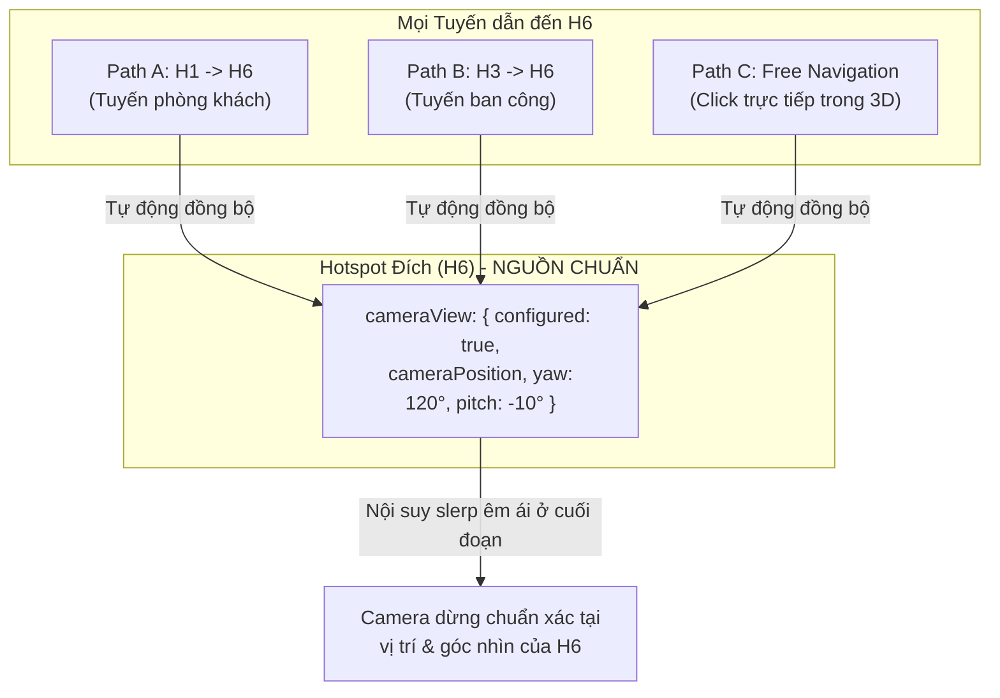

# Kế hoạch Kỹ thuật: Chuyển Hướng nhìn Đích từ Camera Path sang Hotspot

## 1. Mục tiêu Kiến trúc (Goal Description)

Tái cấu trúc quyền sở hữu dữ liệu trong hệ thống Studio:
- **Trước đây:** Mỗi `CameraPath` lưu cấu hình điểm cuối (`endOrientation`, `endPosition`) độc lập. Nếu có 3 tuyến khác nhau cùng dẫn về Hotspot H6 ($H_1 \to H_6$, $H_3 \to H_6$, $H_5 \to H_6$), người dùng phải chỉnh sửa orientation điểm cuối trên từng tuyến riêng lẻ, dễ gây sai lệch và mâu thuẫn góc nhìn tại H6.
- **Kiến trúc mới:** **Hotspot đích (Destination Hotspot) là nguồn dữ liệu chuẩn duy nhất (Single Source of Truth) sở hữu vị trí camera và hướng nhìn chuẩn tại điểm đó.**
  - Mọi Camera Path dẫn đến H6 đều tự động đồng bộ và sử dụng chung vị trí camera và hướng nhìn chuẩn của H6.
  - Khi người dùng thay đổi hướng nhìn của H6, tất cả các tuyến dẫn đến H6 lập tức áp dụng hướng nhìn mới mà không cần chỉnh sửa từng tuyến.
  - Camera Path chỉ quản lý hình học đường đi, danh sách waypoint, thời lượng, độ mượt (easing) và khoảng thời gian chuyển tiếp (transition duration/ratio).
  - Có dịch vụ phát hiện xung đột dữ liệu cũ và migration an toàn lên Schema `v1.2.0`.

---

## 2. Kiểm tra Kiến trúc Hiện tại (Current Architecture Audit)

| Thành phần | Trạng thái hiện tại | Kiến trúc mới |
| :--- | :--- | :--- |
| **Hotspot Data** (`HotspotItem`) | Có `rotation: {x, y, z}` (mặc định 0,0,0). Chưa có cờ đánh dấu đã cấu hình view hay chưa, chưa có trường vị trí camera độc lập (`cameraPosition`). | Bổ sung `cameraView?: HotspotCameraView` gồm `configured: boolean`, `cameraPosition?: Vector3D`, `useCustomPosition?: boolean`, `yaw`, `pitch`, `roll`. Đồng bộ `rotation` với `cameraView`. |
| **Camera Path Data** (`CameraPath`) | Lưu `endOrientation?: PathTerminalOrientation`, `endPosition?: Vector3D`, `useCustomEndPosition?: boolean`. | Giữ lại các trường cũ dưới dạng **Legacy / Fallback**, nhưng nguồn dữ liệu chính khi chạy/preview luôn đọc từ `destHotspot.cameraView`. |
| **Trajectory Evaluator** (`PathTrajectoryEvaluator`) | Đọc `path.endOrientation?.mode === 'custom'` trước, sau đó mới fallback về `toHotspot.rotation`. | Đổi thứ tự ưu tiên: Đọc trực tiếp từ `toHotspot.cameraView` (nếu đã configured) $\to$ nội suy slerp mượt mà ở đoạn cuối $\to$ đảm bảo chính xác 100% tại $u = 1.0$. |
| **Pathfinding & Navigator** | `findOptimalRoute` đọc `path.endPosition` và `destHotspot.rotation`. | Đọc trực tiếp `toHotspot.cameraView` (vị trí camera & hướng nhìn). Nếu chưa cấu hình $\to$ giữ nguyên hướng nhìn hiện tại của camera (không ép về 0,0,0). |
| **Căn chỉnh 3D HUD** | Gắn với `activePath` trên tab Tuyến Camera (`btn-set-end-orient-topbar`). | Tái sử dụng và nâng cấp HUD để căn chỉnh trực tiếp cho **Hotspot** từ tab Hotspot. Trên tab Tuyến Camera, hiển thị thông tin đồng bộ từ Hotspot đích. |
| **Schema Cấu hình** | Schema `v1.0.0` / `v1.1.0`. | Nâng cấp Schema `v1.2.0` có Migration Engine tự động chuyển `endOrientation` cũ vào `cameraView` của Hotspot và báo cáo xung đột nếu có 2 tuyến khác nhau trỏ về cùng một hotspot nhưng khác orientation. |

---

## 3. User Review Required

> [!IMPORTANT]
> **1. Quy tắc giải quyết Xung đột khi Migration dữ liệu cũ:**
> Khi import hoặc tải cấu hình cũ, nếu Hotspot H6 có 2 tuyến dẫn tới với 2 góc nhìn khác nhau (ví dụ Tuyến 1 có Yaw = $45^\circ$, Tuyến 2 có Yaw = $90^\circ$):
> - Hệ thống sẽ **KHÔNG tự ý chọn ngẫu nhiên** một giá trị.
> - `OrientationMigrationService` sẽ tạo báo cáo xung đột chi tiết và mở hộp thoại **"Xử lý Xung đột Hướng nhìn Hotspot"** để người quản trị chủ động chọn góc nhìn chuẩn cho H6.
> 
> **2. Xử lý Hotspot chưa thiết lập hướng nhìn:**
> - Nếu một Hotspot có `cameraView.configured === false`: Khi camera bay đến hotspot này, hệ thống sẽ **giữ nguyên hướng nhìn hiện tại của người dùng** (Free Viewport Orientation), không làm giật camera và không xoay về trục (0, 0, 0).

---

## 4. Chi tiết Thay đổi theo Từng Thành phần (Proposed Changes)



---

### [Component 1] Data Models & Schemas

#### [MODIFY] [hotspot.types.ts](file:///Z:/01_du_an/PRJ_092_3DWeb/src/modules/hotspots/types/hotspot.types.ts)
Bổ sung cấu trúc `HotspotCameraView` và trường `cameraView` vào `HotspotItem`:
```typescript
export interface HotspotCameraView {
  configured: boolean;           // Đã được người dùng thiết lập hướng nhìn chuẩn hay chưa
  useCustomPosition?: boolean;  // Có tách rời vị trí đứng camera khỏi anchor marker hay không
  cameraPosition?: Vector3D;    // Tọa độ camera đứng nhìn (x, y, z)
  yaw: number;                  // Góc xoay ngang (0 - 360 độ)
  pitch: number;                // Góc ngẩng/cúi (-85 đến 85 độ)
  roll: number;                 // Góc nghiêng (mặc định 0)
}

export interface HotspotItem {
  id: string;
  name: string;
  type: 'navigation' | 'info';
  position: Vector3D;           // Tọa độ gắn marker trên bề mặt 3D
  rotation: Vector3D;           // Pitch(x), Yaw(y), Roll(z) (đồng bộ với cameraView)
  cameraView?: HotspotCameraView; // Hướng nhìn chuẩn & vị trí camera của Hotspot
  visible: boolean;
  locked: boolean;
  marker: MarkerStyle;
  source: HotspotSource;
  notes?: string;
  createdAt: string;
  updatedAt: string;
}
```

#### [MODIFY] [cameraPath.types.ts](file:///Z:/01_du_an/PRJ_092_3DWeb/src/modules/camera-path/types/cameraPath.types.ts)
Đánh dấu trường `endOrientation` và `endPosition` là deprecated/legacy, chỉ giữ vai trò tương thích ngược.

#### [MODIFY] [config.types.ts](file:///Z:/01_du_an/PRJ_092_3DWeb/src/modules/config/types/config.types.ts)
Cập nhật `ProjectConfigSchema.schemaVersion` hỗ trợ `'1.2.0'` (tương thích backward với `'1.0.0'` và `'1.1.0'`).

---

### [Component 2] Dịch vụ Di chuyển Dữ liệu & Phát hiện Xung đột

#### [NEW] [OrientationMigrationService.ts](file:///Z:/01_du_an/PRJ_092_3DWeb/src/modules/camera-path/services/OrientationMigrationService.ts)
- Quét toàn bộ `cameraPaths` và `hotspots`.
- Phát hiện các tuyến cùng đích đến nhưng có `endOrientation` khác nhau.
- Tạo báo cáo danh sách xung đột:
  ```typescript
  export interface OrientationConflict {
    hotspotId: string;
    hotspotName: string;
    conflictingPaths: Array<{
      pathId: string;
      pathName: string;
      yaw: number;
      pitch: number;
      position?: Vector3D;
    }>;
  }
  ```
- Hàm `migrateConfig(config: ProjectConfigSchema): MigrationResult`:
  - Di chuyển an toàn các `endOrientation` không xung đột vào `hotspot.cameraView`.
  - Giữ lại bản sao lưu (`_legacyEndOrientation`) trên `CameraPath` để có thể rollback nếu cần.

---

### [Component 3] Giao diện Quản lý Hotspot & Căn chỉnh 3D trực quan

#### [MODIFY] [index.html](file:///Z:/01_du_an/PRJ_092_3DWeb/index.html)
- Trên bảng thuộc tính Hotspot (`#inspector-content`):
  - Hiển thị khối trạng thái:
    - Huy hiệu: `[ Chưa thiết lập hướng nhìn ]` (màu xám/vàng) hoặc `[ Hướng nhìn chuẩn: Yaw ...°, Pitch ...° ]` (màu xanh).
  - Nút chính: **`🎥 Căn chỉnh hướng nhìn & Vị trí Camera 3D`** (mở HUD tương tác 3D).
  - Nút phụ: **`📷 Chụp nhanh góc nhìn hiện tại`**.
  - Nút: **`👁️ Xem trước hướng nhìn chuẩn`**.
  - Nút: **`🔄 Đặt lại (Góc nhìn tự do)`**.
- Cập nhật tiêu đề và nhãn trên HUD căn chỉnh (`#end-orientation-hud`) để hiển thị rõ tên Hotspot đang được căn chỉnh:
  - *"Căn chỉnh Hướng nhìn chuẩn cho Hotspot: [Tên Hotspot]"*.

#### [MODIFY] [PropertyPanel.ts](file:///Z:/01_du_an/PRJ_092_3DWeb/src/modules/hotspots/ui/PropertyPanel.ts)
- Bổ sung logic hiển thị thông tin `cameraView` của Hotspot.
- Khi người dùng thay đổi Yaw/Pitch trong ô nhập số hoặc nhấn nút lưu:
  - Cập nhật cả `cameraView` và `rotation`.
  - Lưu vào `CommandHistory` qua `UpdateHotspotCommand` (hỗ trợ Undo/Redo hoàn toàn).
  - Phát sự kiện `hotspot:updated` để hệ thống tự động làm mới tất cả các đường path trỏ đến hotspot này.

#### [MODIFY] [PathPropertyPanel.ts](file:///Z:/01_du_an/PRJ_092_3DWeb/src/modules/camera-path/ui/PathPropertyPanel.ts)
- Điều chỉnh phần "Hướng nhìn điểm cuối":
  - Thay vì cho phép sửa orientation riêng trên path, hiển thị thông báo liên kết:
    *"Hướng nhìn điểm cuối được liên kết tự động từ Hotspot đích: **[Tên Hotspot]**"*.
  - Có nút shortcut: **`Chỉnh sửa hướng nhìn trên Hotspot đích`** (tự động chuyển focus sang Hotspot đích để chỉnh).

---

### [Component 4] Động cơ Nội suy Chuyển động (Trajectory Evaluator & Navigation)

#### [MODIFY] [PathTrajectoryEvaluator.ts](file:///Z:/01_du_an/PRJ_092_3DWeb/src/modules/camera-path/services/PathTrajectoryEvaluator.ts)
- Cập nhật hàm `getEndQuaternion(path: CameraPath)`:
  ```typescript
  public getEndQuaternion(path: CameraPath): THREE.Quaternion | null {
    // 1. NGUỒN CHUẨN ƯU TIÊN: Đọc từ Hotspot đích
    if (this.toHotspot?.cameraView?.configured) {
      return this.eulerToQuaternion(
        this.toHotspot.cameraView.yaw,
        this.toHotspot.cameraView.pitch,
        this.toHotspot.cameraView.roll || 0
      );
    }
    // 2. Fallback: Nếu hotspot có rotation != 0
    if (this.toHotspot?.rotation && (this.toHotspot.rotation.x !== 0 || this.toHotspot.rotation.y !== 0)) {
      return this.eulerToQuaternion(this.toHotspot.rotation.y, this.toHotspot.rotation.x, this.toHotspot.rotation.z || 0);
    }
    // 3. Fallback: Legacy path endOrientation (nếu có trong dữ liệu cũ chưa migrate)
    if (path.endOrientation && path.endOrientation.mode === 'custom' && path.endOrientation.yaw !== undefined) {
      return this.eulerToQuaternion(path.endOrientation.yaw, path.endOrientation.pitch || 0, path.endOrientation.roll || 0);
    }
    // 4. Nếu chưa cấu hình: Giữ nguyên hướng nhìn theo tiếp tuyến hoặc không ép góc
    return null;
  }
  ```
- Cập nhật hàm `resolveHotspotCameraPosition`:
  - Ưu tiên `toHotspot.cameraView?.useCustomPosition ? toHotspot.cameraView.cameraPosition : toHotspot.position + 1.2m`.

#### [MODIFY] [CameraPathfindingService.ts](file:///Z:/01_du_an/PRJ_092_3DWeb/src/modules/camera-path/services/CameraPathfindingService.ts)
- Hàm `findOptimalRoute(...)`:
  - Điểm đến `pDest` và góc quay `qDest` được trích xuất trực tiếp từ `destHotspot.cameraView`.
  - Nếu `destHotspot.cameraView?.configured === false`: `targetQuaternion = currentCameraQuaternion.clone()` (không tự xoay về $-Z$).

#### [MODIFY] [EditorApp.ts](file:///Z:/01_du_an/PRJ_092_3DWeb/src/EditorApp.ts)
- Nâng cấp chức năng HUD Căn chỉnh 3D:
  - Thêm hàm `startAligningHotspotCameraView(hotspot: HotspotItem)`.
  - Khi lưu trên HUD: Cập nhật trực tiếp `hotspot.cameraView` và `hotspot.rotation`.
  - Tự động gọi `syncActivePathVisuals()` để mọi Camera Path dẫn tới Hotspot này tự động cập nhật ngay lập tức.

---

## 5. Kế hoạch Kiểm thử Toàn diện (Verification Plan)

### 5.1. Automated Tests (`tests/verify_hotspot_orientation_architecture.mjs`)
Chạy bộ test độc lập bằng lệnh Node:
```powershell
node --experimental-strip-types tests/verify_hotspot_orientation_architecture.mjs
```
Bộ test bao gồm 8 kịch bản kiểm tra:
1. **Test 1 — Hotspot Data Model & CameraView**: Khởi tạo hotspot, cấu hình `cameraView`, kiểm tra đồng bộ giữa `cameraView` và `rotation`.
2. **Test 2 — Nhiều tuyến đến cùng Hotspot**: Tạo 2 Camera Path $H_1 \to H_6$ và $H_3 \to H_6$. Đặt orientation của $H_6$. Đánh giá `PathTrajectoryEvaluator` cho cả hai tuyến $\to$ cả hai đều cho ra chính xác 100% cùng một `qEnd`.
3. **Test 3 — Thay đổi orientation của Hotspot**: Đổi Yaw của $H_6$ từ $45^\circ$ thành $135^\circ$ mà KHÔNG sửa bất kỳ Camera Path nào $\to$ cả 2 tuyến tự động đánh giá ra `qEnd` mới tương ứng $135^\circ$.
4. **Test 4 — Độ mượt và không giật ở điểm cuối**: Đo đạc giá trị Quaternion trong đoạn transition ($u = 0.8 \to 1.0$) $\to$ Quaternion biến thiên liên tục, không có bước nhảy đột ngột, $u = 1.0$ đạt sai số $< 10^{-6}$.
5. **Test 5 — Điều hướng Camera thông minh qua Pathfinding**: Tìm đường từ vị trí bất kỳ đến $H_6$ $\to$ `targetQuaternion` lấy từ $H_6$.
6. **Test 6 — Phát hiện Xung đột (Conflict Detection Engine)**: Đưa vào 2 path cũ có orientation lệch nhau $\to$ `OrientationMigrationService` phát hiện xung đột và trả về báo cáo chính xác.
7. **Test 7 — Migration Schema v1.1.0 sang v1.2.0**: Thực hiện migration dữ liệu hợp lệ $\to$ Schema nâng lên `1.2.0`, hotspot nhận đúng `cameraView`, dữ liệu cũ được giữ an toàn.
8. **Test 8 — Hotspot chưa cấu hình (Fallback an toàn)**: Hotspot chưa cấu hình orientation $\to$ không ép xoay về $(0,0,0)$, giữ nguyên hướng nhìn hiện tại của camera.

Ngoài ra, chạy kiểm thử hồi quy 2 bộ test trước để đảm bảo không hồi quy bất kỳ tính năng nào:
```powershell
node tests/verify_camera_path.mjs
node --experimental-strip-types tests/verify_waypoint_gizmo_navigation.mjs
```

### 5.2. Manual Verification trên Trình duyệt Chrome
Sau khi dev server chạy, người dùng trực tiếp mở Chrome tại `http://localhost:5173/`:
1. **Kiểm tra thiết lập hướng nhìn cho Hotspot:**
   - Chọn Hotspot "Phòng ngủ Master" trên danh sách bên trái.
   - Nhấn nút "🎥 Căn chỉnh hướng nhìn & Vị trí Camera 3D".
   - Tự do xoay camera trong không gian phòng ngủ đến góc ưng ý, nhấn "Lưu cả Vị trí & Hướng nhìn".
2. **Kiểm tra tự động đồng bộ trên nhiều tuyến:**
   - Tạo 2 tuyến khác nhau cùng dẫn về "Phòng ngủ Master".
   - Nhấn chạy thử tuyến 1 và tuyến 2 $\to$ xác nhận camera đều kết thúc tại đúng góc nhìn vừa lưu của Phòng ngủ Master.
3. **Kiểm tra thay đổi góc nhìn:**
   - Đổi hướng nhìn của Phòng ngủ Master sang hướng cửa sổ.
   - Chạy lại các tuyến $\to$ tự động hướng về cửa sổ mà không cần mở lại các tuyến.
