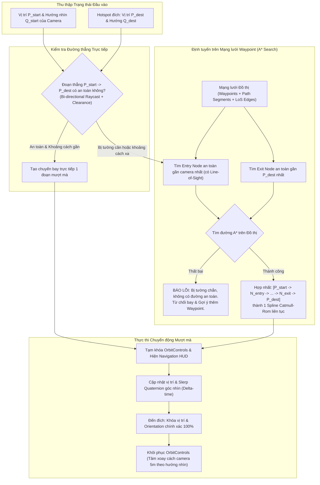

# Kế hoạch Triển khai: Bổ sung Di chuyển Waypoint bằng Gizmo và Tự động Tìm đường Camera Thông minh trên Mạng lưới Waypoint

## 1. Goal Description (Mục tiêu tổng quát)

Nâng cấp hệ thống 3D Web Hotspot & Camera Path Studio (`PRJ_092_3DWeb`) để hoàn thiện hai năng lực cốt lõi:

1. **Chức năng A — Di chuyển Waypoint trực tiếp bằng Gizmo XYZ trên mô hình 3D:**
   - Cho phép người dùng nhấp chọn waypoint trực tiếp trong không gian 3D (3D raycasting).
   - Hiển thị Gizmo 3D (3 trục X, Y, Z phân biệt) tại vị trí waypoint đã chọn.
   - Kéo mũi tên để di chuyển waypoint theo trục tương ứng trong thời gian thực, đồng thời cập nhật tức thời hình học đường cong spline và bảng tọa độ.
   - Khắc phục triệt để lỗi tham chiếu: không hủy và tái tạo mesh anchor trong lúc kéo gizmo (tránh gizmo bị văng hoặc mất điều khiển).
   - Tích hợp đầy đủ `MoveWaypointCommand` vào lịch sử Undo/Redo, hỗ trợ phím `Escape` hủy thao tác kéo hoặc bỏ chọn.
   - Đánh dấu trạng thái cấu hình là chưa lưu (`dirty`) và đảm bảo lưu/tải lại giữ nguyên tọa độ mới.

2. **Chức năng B — Tự động Tìm đường Camera Thông minh khi nhấn Marker ở bất kỳ vị trí nào:**
   - Khi người dùng đang ở **bất kỳ vị trí nào trong không gian 3D** (đang đi dạo Walk/Fly, đang Orbit tự do, đang đứng tại waypoint hay giữa phòng) và nhấn vào một Hotspot đích trong chế độ **Preview / Navigation Mode**:
     - Lấy vị trí $P_{start}$ và hướng nhìn thực tế $Q_{start}$ của camera tại thời điểm nhấn.
     - Lấy vị trí camera đích $P_{dest}$ và orientation đích $Q_{dest}$ đã lưu của Hotspot (tách biệt rõ vị trí marker trên bề mặt và vị trí đứng của camera).
     - Xây dựng **Đồ thị Điều hướng (Navigation Graph)** từ toàn bộ mạng lưới Waypoint và các Camera Path đã cấu hình. Không bắt buộc người dùng phải cấu hình riêng từng cặp hotspot nếu chúng có thể dùng chung các đoạn waypoint trung gian.
     - Tìm kiếm đường đi tối ưu bằng thuật toán **A\* / Dijkstra** kết hợp kiểm tra hình học va chạm hai chiều (**Bi-directional Raycast Collision Checking** với bán kính an toàn).
     - Nếu camera đang nằm trên một đoạn đường đã có: tìm điểm gần nhất trên đoạn đó để hòa vào mạng route.
     - Nếu camera đang ở ngoài mạng lưới: tìm waypoint hoặc đoạn đường gần nhất có **đường nhìn an toàn (Line-of-Sight không bị cản bởi tường/đồ nội thất)** để tạo đoạn nối tự động.
     - Tuyệt đối **không dùng đường thẳng xuyên tường** làm fallback mặc định nếu đường đó chưa được kiểm tra hình học.
     - Nếu bị tường ngăn cách và không có đường đi an toàn: hiển thị thông báo cảnh báo rõ ràng và hướng dẫn người dùng bổ sung waypoint, **tuyệt đối không cho camera bay xuyên tường**.
     - Khi tìm được đường: kết hợp đoạn nối, chuỗi waypoint và đoạn kết thúc thành một **hành trình camera thống nhất (Unified Trajectory)**. Làm mượt vị trí và hướng nhìn liên tục, không dừng hay giật cục tại các waypoint trung gian.
     - Đến đích: Khóa vị trí và orientation camera chính xác 100% như đã lưu.
     - Hỗ trợ **ngắt mượt mà (Clean Interruption):** Nếu đổi đích giữa chừng, hủy chuyển động cũ và chuyển hướng êm ái sang đích mới từ vị trí hiện thời.

---

## 2. Đánh giá Hiện trạng & Giới hạn của Phương pháp Waypoint-Only

> [!WARNING]
> ### Đánh giá chuyên sâu về vị trí Camera tự do & Ranh giới an toàn:
> 
> Trong mô hình kiến trúc 3D (nội thất căn hộ):
> 1. **Trường hợp An toàn (Camera nằm trong tầm nhìn của Mạng lưới Waypoint):**
>    - Khi camera đang ở cùng không gian phòng với ít nhất một waypoint hoặc đoạn đường, kiểm tra tia (Raycast) xác nhận không có vật cản. Hệ thống có thể nối camera vào đồ thị và tìm đường hoàn hảo qua các phòng khác bằng mạng waypoint hành lang.
> 
> 2. **Trường hợp Rủi ro / Giới hạn thực tế (Camera bị cô lập sau tường):**
>    - Nếu camera đang ở trong một góc kín (ví dụ: phòng ngủ hoặc nhà vệ sinh) mà người quản trị **chưa đặt bất kỳ waypoint nào bên trong phòng đó**:
>    - Tất cả các tia nối từ camera tới các waypoint bên ngoài đều bị các bức tường của phòng chặn lại.
>    - **Giới hạn kỹ thuật:** Khi chỉ có dữ liệu Waypoint mà không có lưới điều hướng tự động toàn diện (3D NavMesh / Voxel Grid bao phủ toàn bộ sàn nhà), hệ thống **không thể tự sáng tạo ra một đường lượn qua khe cửa hẹp** nếu không có waypoint dẫn đường qua cửa.
>    - **Nguyên tắc An toàn Tối thượng:** Hệ thống **KHÔNG BAO GIỜ** tự tiện coi đường thẳng nối qua tường là an toàn. Nếu không tìm thấy đường nối có Line-of-Sight an toàn, hệ thống sẽ **từ chối bay**, giữ camera ổn định và hiển thị thông báo hướng dẫn:
>      *"Không tìm thấy đường bay an toàn từ vị trí hiện tại đến đích (bị chặn bởi tường/vật cản). Hãy di chuyển camera ra khu vực thoáng hoặc bổ sung thêm waypoint dẫn đường."*
> 
> 3. **Phát hiện Va chạm Hai chiều (Bi-directional Raycast Check):**
>    - Nhiều mô hình 3D kiến trúc có các bức tường mỏng chỉ có 1 mặt (Single-sided geometry). Bắn tia từ một phía có thể bị lọt qua mặt sau. Hệ thống sẽ bắn tia 2 chiều ($A \to B$ và $B \to A$) kèm kiểm tra độ dày/lệch tâm $\pm 0.25m$ để phát hiện triệt để cả tường mỏng lẫn cột nhà.

---

## 3. Kiến trúc Đồ thị & Luồng Tự tìm đường (A* Navigation Graph)



---

## 4. Proposed Changes (Chi tiết các tệp sẽ chỉnh sửa & tạo mới)

### Component 1: Bộ Dịch vụ Tìm đường Thông minh (Camera Pathfinding Service)

#### [NEW] `src/modules/camera-path/services/CameraPathfindingService.ts`
- **Mục tiêu:** Quản trị cấu trúc dữ liệu đồ thị và thuật toán A* tìm đường:
  - **Xây dựng Đồ thị (Graph Building):**
    - Đỉnh (Nodes): Toàn bộ Waypoint và các vị trí camera của Hotspot.
    - Cạnh (Edges): Các đoạn đường từ các `CameraPath` đã cấu hình (chiều xuôi/ngược), cộng với các liên kết Line-of-Sight hợp lệ giữa các waypoint lân cận.
    - Trọng số cạnh: Độ dài hình học đường cong + Hệ số phạt góc quay gắt (Turn Angle Penalty) để ưu tiên đường bay êm ả, ít cua gấp.
  - **Kiểm tra An toàn Đường nhìn (Line-of-Sight Checker):**
    - Phương thức `isLineSafe(p1: THREE.Vector3, p2: THREE.Vector3, sceneRoot: THREE.Object3D, clearanceRadius?: number): boolean`:
    - Bắn tia 2 chiều ($p_1 \to p_2$ và $p_2 \to p_1$).
    - Bắn thêm các tia phụ lệch tâm $\pm 0.25m$ theo phương ngang để đảm bảo thân camera không quẹt mép tường hoặc cửa ra vào.
  - **Kết nối Camera hiện tại vào Đồ thị:**
    - Nếu camera đang ở trên một đường cong path hiện có: tính hình chiếu (Projection) của camera lên spline.
    - Nếu camera đang ở tự do: lọc các node có `isLineSafe == true`, chọn node có tổng chi phí dự tính $(Distance + Heuristic)$ nhỏ nhất.
  - **Thuật toán A\*:**
    - Tìm đường từ Entry Node đến Exit Node.
  - **Hợp nhất Hành trình (Unified Trajectory Builder):**
    - Xây dựng mảng điểm điều khiển duy nhất: $[P_{start}, N_1, N_2, \dots, N_k, P_{dest}]$.
    - Xây dựng đường cong `CatmullRomCurve3` với tham số `centripetal` (chống vòng lặp dị thường).
    - Tạo bảng góc nhìn (Orientations timeline) khớp chính xác: $Q_{start}$ tại $u=0$, chuyển tiếp mượt theo hướng chuyển động hoặc góc nhìn waypoint, và kết thúc bằng Slerp chính xác vào $Q_{dest}$ tại $u=1.0$.

---

### Component 2: Tương tác Waypoint 3D & Cập nhật Trajectory thời gian thực

#### [MODIFY] `src/modules/camera-path/components/Path3DVisualizer.ts`
- **Mục tiêu:**
  1. Thêm phương thức `pickWaypoint(raycaster: THREE.Raycaster): string | null`: Cho phép click chọn waypoint trực tiếp trong không gian 3D.
  2. Bổ sung `updateTrajectoryOnly(path: CameraPath, evaluator: PathTrajectoryEvaluator)`: Cập nhật hình học của `curveMesh` (Spline) trong lúc người dùng kéo gizmo mà **không hủy** và tạo lại các anchor waypoint trong `waypointGroup` (khắc phục dứt điểm lỗi TransformControls bị văng).
  3. Bổ sung `updateWaypointSelection(selectedWpId: string | null)`: Đổi màu sắc phát sáng (Cyan khi chọn, Hổ phách khi thường) trực tiếp trên mesh hiện có.
  4. Bổ sung hiệu ứng hover cursor (chuyển sang `pointer`) khi rê chuột qua waypoint marker.

---

### Component 3: Quản lý Gizmo XYZ & Phím tắt

#### [MODIFY] `src/core/gizmo/TransformGizmoManager.ts`
- **Mục tiêu:**
  1. Thêm phương thức `cancelDrag()`: Cho phép hủy thao tác kéo dở dang nếu người dùng nhấn `Escape`, khôi phục vị trí `startPosition` ban đầu.
  2. Cung cấp getter `getAttachedObject()`.

#### [MODIFY] `src/EditorApp.ts`
- **Mục tiêu:**
  1. Trong hàm khởi tạo `gizmoManager.onDrag`: Khi `activeMode === 'paths'`, cập nhật vị trí `wp.position`, tính toán lại `trajectoryEvaluator`, gọi `pathVisualizer.updateTrajectoryOnly(...)`, cập nhật các ô nhập số trên `pathPropertyPanel` mà không gọi `clearVisuals()`.
  2. Trong `gizmoManager.onDragEnd`: Thực thi lệnh `MoveWaypointCommand` vào `this.history` để hỗ trợ Undo/Redo hoàn hảo, kích hoạt cờ dirty cho `pathStore`.
  3. Trong xử lý sự kiện `pointerdown` trên viewport:
     - Gọi `pathVisualizer.pickWaypoint(raycaster)`.
     - Nếu trúng waypoint và đang ở Edit Mode: tự động kích hoạt chế độ `paths`, chọn waypoint đó và gắn gizmo XYZ. Nếu waypoint bị khóa (`wp.locked`), thông báo Toast rõ ràng.
     - Nếu đang ở Preview Mode: gọi hàm điều hướng camera tới waypoint đó!
  4. Trong xử lý phím `Escape`:
     - Nếu gizmo đang kéo: gọi `gizmoManager.cancelDrag()`.
     - Nếu waypoint đang được chọn: bỏ chọn và tháo gizmo (`detach()`).

---

### Component 4: Bộ Điều phối Điều hướng Camera Thực tế (Camera Navigator)

#### [NEW] `src/core/navigation/CameraNavigator.ts`
- **Mục tiêu:**
  - Tích hợp `CameraPathfindingService`, `PathPlaybackController`, và `CameraTween`.
  - Quản trị trạng thái bay: `idle | flying`.
  - Phương thức `navigateToHotspot(destHotspot: HotspotItem)`:
    - Lấy $P_{start}, Q_{start}$ hiện tại của camera.
    - Lấy $P_{dest}, Q_{dest}$ của Hotspot đích.
    - Gọi `pathfindingService.findOptimalRoute(...)`.
    - Nếu tìm thấy tuyến: kích hoạt chuyến bay mượt mà trên Unified Trajectory, khóa `OrbitControls`, hiển thị HUD: *"Đang bay đến [Tên Hotspot] (Qua X điểm trung gian)..."*.
    - Nếu không tìm thấy đường an toàn: phát âm báo/Toast cảnh báo: *"Không tìm thấy đường bay an toàn (bị tường chắn). Hãy di chuyển camera ra khu vực thoáng hoặc thêm waypoint."*, **không di chuyển camera**.
  - Phương thức `navigateToWaypoint(wp: CameraWaypoint)`:
    - Điều hướng camera mượt mà đến vị trí và orientation của waypoint.
  - **Chính sách ngắt (Interruption):**
    - Nếu người dùng nhấn marker mới khi đang bay: lập tức dừng hành trình cũ, lấy vị trí/hướng nhìn hiện thời làm điểm xuất phát mới và tìm đường tiếp tới đích mới.
  - **Phương thức `stop()`:**
    - Dừng bay tức thời khi nhấn `Escape` hoặc nút `[Dừng lại]` trên HUD.

---

### Component 5: Giao diện Chế độ Edit vs Preview & Navigation HUD

#### [MODIFY] `index.html`
- **Mục tiêu:**
  1. Thêm công tắc chuyển chế độ `[Biên tập]` / `[Điều hướng]` trên topbar (`#view-mode-toggle`).
  2. Thêm widget nổi `Navigation Flight HUD` (`#navigation-flight-hud`) hiển thị trạng thái khi camera đang bay cùng nút `[Dừng lại]` (`#btn-stop-flight`).

#### [MODIFY] `src/styles/layout.css` & `src/styles/components.css`
- **Mục tiêu:**
  - CSS cho `#view-mode-toggle` và `#navigation-flight-hud` với phong cách kính mờ cao cấp.
  - Thu gọn thanh bên mượt mà khi vào Preview Mode để không gian 3D đạt tối đa.

#### [MODIFY] `src/modules/hotspots/components/HotspotMarker2D.ts`
- **Mục tiêu:**
  - Xử lý click: Chế độ Edit -> chọn hotspot; Chế độ Preview -> gọi `navigator.navigateToHotspot(item)`.

---

## 5. Verification Plan (Kế hoạch Kiểm thử Toàn diện)

### 5.1. Automated Tests (Kiểm thử Tự động với Node.js)
Tạo tệp kiểm thử tự động `tests/verify_waypoint_gizmo_navigation.mjs` chạy qua lệnh:
```powershell
node tests/verify_waypoint_gizmo_navigation.mjs
```
Các kịch bản kiểm thử tự động gồm:
1. **Kiểm thử Waypoint Manipulation & Undo/Redo:**
   - Di chuyển waypoint qua `MoveWaypointCommand`.
   - Kiểm tra `Undo` khôi phục tọa độ cũ, `Redo` khôi phục tọa độ mới.
2. **Kiểm thử Raycast Waypoint Picking:**
   - Kiểm tra thuật toán phát hiện chọn waypoint 3D bằng tia raycaster.
3. **Kiểm thử Line-of-Sight Collision Checker:**
   - Kiểm tra 2 điểm có đường thẳng thoáng -> Trả về `true`.
   - Kiểm tra 2 điểm bị chắn bởi tường mesh -> Trả về `false`.
4. **Kiểm thử Thuật toán Tìm đường A\* trên Đồ thị:**
   - Tạo đồ thị có 3 phòng nối qua hành lang. Kiểm tra tìm đường từ Phòng 1 qua Hành lang đến Phòng 3.
   - Kiểm tra trường hợp phòng bị bít kín tường -> Trả về `BLOCKED_BY_GEOMETRY`.
5. **Kiểm thử Unified Trajectory & Slerp Quaternion:**
   - Kiểm tra tính liên tục của vị trí và hướng nhìn dọc theo toàn bộ hành trình; kiểm tra độ chính xác tuyệt đối tại $u=1.0$ đạt đúng góc $Q_{dest}$.
6. **Kiểm thử Interruption & Cancellation:**
   - Ngắt hành trình giữa chừng tại $u=0.4$ và tạo hành trình mới từ vị trí hiện thời.

### 5.2. Manual Verification (Kiểm thử Thủ công theo 7 Tình huống Người dùng yêu cầu)

Mở trình duyệt tại [http://localhost:5173/](http://localhost:5173/) và kiểm tra:

1. **Test 1: Di chuyển Waypoint bằng Gizmo XYZ (Edit Mode):**
   - Nhấp trực tiếp vào waypoint trên mô hình 3D.
   - Xác nhận Gizmo 3 mũi tên XYZ xuất hiện. Kéo trục X, Y, Z -> xác nhận waypoint và đường cong spline uốn lượn theo thời gian thực.
   - Nhấn `Ctrl+Z` hoàn tác, `Ctrl+Y` làm lại. Nhập số trên thanh thuộc tính. Khóa waypoint. Lưu và tải lại.
2. **Test 2: Camera đang ở trên một Camera Path:**
   - Vào Preview Mode. Đang chạy dở trên tuyến, nhấp vào một Hotspot khác.
   - Xác nhận camera chuyển tiếp mượt mà từ điểm hiện tại trên tuyến sang lộ trình mới.
3. **Test 3: Camera đang đứng tại một Waypoint:**
   - Nhấp vào một Hotspot đích -> camera bay theo đường nối an toàn tới Hotspot đích và quay về đúng hướng đã lưu.
4. **Test 4: Camera đang ở giữa phòng, không trùng Waypoint:**
   - Dùng chuột Orbit hoặc Walk/Fly đưa camera vào giữa phòng khách. Nhấp vào Hotspot Bếp.
   - Xác nhận camera tự động nối từ vị trí giữa phòng vào hành lang rồi đi tới bếp mượt mà, không dừng khựng tại các góc rẽ.
5. **Test 5: Camera muốn đi tới Hotspot ở khu vực khác:**
   - Từ phòng ngủ master đi tới ban công (qua nhiều khúc rẽ). Camera di chuyển liên tục theo chuỗi waypoint hành lang.
6. **Test 6: Camera bị ngăn cách với đích bởi tường (Không có đường hợp lệ):**
   - Đưa camera vào một vị trí bị tường che kín và không có waypoint nào nhìn thấy. Nhấp vào Hotspot sau bức tường.
   - Xác nhận hệ thống **KHÔNG bay xuyên tường**, hiển thị thông báo cảnh báo rõ ràng và gợi ý tạo thêm waypoint.
7. **Test 7: Người dùng đổi Hotspot đích trong lúc camera đang di chuyển:**
   - Khi camera đang bay dở chừng tới Bếp, nhấp ngay vào Hotspot Ban công.
   - Xác nhận hành trình cũ bị hủy ngay tức khắc, camera lượn êm ái sang lộ trình mới mà không bị giật, rung hay tranh chấp điều khiển.
8. **Test 8: Dừng khẩn cấp và Chuyển chế độ:**
   - Nhấn `[Dừng lại]` trên HUD hoặc nhấn phím `Escape` khi camera đang bay -> camera dừng ngay tại chỗ, khôi phục chuột xoay Orbit.
   - Chuyển về chế độ `Biên tập` -> toàn bộ công cụ chỉnh sửa hiển thị lại nguyên vẹn.
